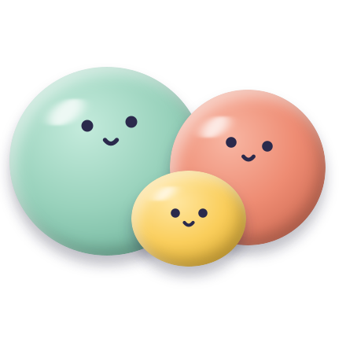

# JmkFamily 사이트 스타일 가이드 v2 (assets/css/site.css)

CSS 담당(web-css) 작성, 기준 명세 `web/docs/plan-v2.md`. 개발자는 이 문서의 클래스 이름과 마크업 골격을 그대로 쓰세요. 운영자 화면(`admin.css`)은 별개이며 이 파일을 읽지 않습니다.

```html
<link rel="preconnect" href="https://fonts.googleapis.com">
<link rel="preconnect" href="https://fonts.gstatic.com" crossorigin>
<link href="https://fonts.googleapis.com/css2?family=Noto+Sans+KR:wght@400;600;700&display=swap" rel="stylesheet">
<link rel="stylesheet" href="/assets/css/site.css">
<script>document.documentElement.classList.add('js')</script>  <!-- 등장 효과용. 없으면 효과만 꺼짐 -->
```

## 규칙 요약

- BEM(`block__element--modifier`), 상태 `is-open`·`is-in`·`is-hidden`, 스크립트 연결 `data-js`, 보조 `u-*`. 글꼴은 한 가지(시스템/Noto Sans KR), 굵기로만 위계.
- 테마: `prefers-color-scheme` 자동, `<html data-theme="light|dark">`로 강제 가능. 언어: `<span lang="ko" data-l="ko">…</span><span lang="en" data-l="en">…</span>`, 둘 다 보일 페이지는 `<body class="is-bilingual">`.
- `.reveal`은 구역 안 큰 덩어리에만(`html.js`일 때 페이드 + 16px, 600ms 1회, 줄인 움직임이면 즉시). 히어로 글·그림은 CSS가 알아서 등장하니 `.reveal` 금지.
- 페이지 머리와 본문 첫 덩어리는 `.enter`(JS 불필요, 페이드 + 16px, 600ms 1회, `--d`로 덩어리 지연 예 `120ms`, `--i`로 목록 순번 0~6, 40ms 간격), 스크롤 아래는 `.reveal`(`--i` 순차 지원). `.enter--fade`는 긴 글(`.prose`)용 페이드만. 히어로에는 둘 다 금지. 카드·버튼처럼 hover/누름 전환이 있는 요소에는 `.reveal`을 직접 붙이지 말고 감싼 요소에.
- 히어로 심볼은 ``(88px, 900px부터 112px, 어두운 테마는 `--c-tint` 받침 원 자동). `.game-grid` 안 카드가 1장뿐이면 최대 880px 가운데. 피처드 아래 버튼 줄은 `<p class="hero__cta">`를 `.section` 안에서 그대로 사용.
- `[hidden]`은 항상 숨김. 가로 스크롤 없음(단 `.shots`만 폰에서 스냅 스크롤, `tabindex="0"`+`aria-label`).
- 그림 ``에는 `width`·`height`·`alt`. 그림이 없으면 마크업 자체를 내보내지 않습니다(빈 상자 금지).
- 헤더 숨김은 `.site-header.is-hidden`(top 이동). 헤더에 `transform`·`backdrop-filter`를 직접 걸지 않습니다(전체 화면 메뉴가 깨짐). 흐림 효과는 CSS가 가상요소로 처리.

## 토큰

| 토큰 | 밝음 | 어두움 |
|---|---|---|
| `--c-bg` / `--c-bg-alt` / `--c-surface` | #FFFFFF / #F4F4F6 / #FFFFFF | #0D0D10 / #17171B / #1E1E23 |
| `--c-ink` / `--c-ink-soft` / `--c-line` | #16161A / #62626B / #E3E3E8 | #F3F3F6 / #A3A3AD / #2E2E35 |
| `--c-band` / `--c-on-band` | #16161A / #FFFFFF | #000000 / #F3F3F6 |
| `--c-accent` / `--c-on-accent` / `--c-tint` | #5A4FCF / #FFFFFF / #F1EFFC | #A99BFF / #0D0D10 / #1D1A2E |
| `--c-link`, `--c-eyebrow` | = accent | = accent |
| `--c-danger` | #C62F3B | #FF8A93 |

글꼴 `--f-body`. 타입 `--t-display / -h1 / -h2 / -h3 / -lead / -body / -small / -eyebrow`(360→1280 `clamp`). 간격 `--sp-1…10`(4…128), 라운드 `--r-s/m/l/pill`(8/14/24/999), `--shadow`(떠 있는 메뉴만), `--wrap` 1080px, `--ease`.
삭제된 토큰: `--c-sky*`, `--c-hot`, `--c-mint*`, `--c-road`, `--c-khaki`, `--c-sticker`, `--c-navy`, `--f-display`, `--shadow-s`.

## 마크업 골격

### 헤더·푸터

```html
<header class="site-header"><div class="wrap site-header__in">
  <a class="site-header__logo" href="/" aria-label="JmkFamily 홈">
    
    <span class="site-header__word">JmkFamily</span></a>
  <nav class="site-nav" id="site-nav">…<a class="site-nav__link" href="…" aria-current="page">…</a></nav>
  <div class="lang-switch">…<button class="lang-switch__btn" aria-pressed="true">한국어</button></div>
  <button class="menu-btn" aria-expanded="false"><span class="menu-btn__bar"></span>×3</button>
</div></header>

<footer class="site-footer"><div class="wrap">
  <ul class="site-footer__links"><li><a href="…">…</a></li></ul>
  <div class="site-footer__end"><p class="site-footer__copy">…</p>
    </div>
</div></footer>
```

### 구역

```html
<section class="section [section--alt|section--tight]">
  <div class="wrap">
    <div class="section__head reveal">      <!-- 가운데 정렬 머리 -->
      <p class="section__eyebrow">…</p><h2 class="section__title">…</h2><p class="section__lead">…</p>
    </div>
    …내용…
  </div>
</section>
```

### 히어로 (그림 없으면 1단 가운데, 있으면 `hero--has-visual`로 900px부터 2단)

```html
<section class="hero [hero--compact] [hero--has-visual]"><div class="wrap hero__in">
  <div class="hero__copy">
    <p class="hero__tag">…</p><h1 class="hero__title">…</h1><p class="hero__lead">…</p>
    <div class="hero__cta"><a class="btn btn--play">…</a><a class="text-link">…</a><span class="soon-badge">…</span></div>
  </div>
  <figure class="visual visual--hero"></figure>      <!-- 그림이 있을 때만 -->
</div></section>
```

### 그림 자리 (`visual`)

`<figure class="visual visual--hero|sd|story|card"></figure>`
hero 폰 1:1(위쪽 기준)·900 이상 4:5 / sd 원형 `--c-tint` 받침(200→280px), `contain` / story 폰 4:3·900 이상 3:2 / card 16:9. 둥근 24, 테두리·그림자 없음.

### 놀이 방법 `steps`

```html
<ol class="steps"><li class="step"><span class="step__num">1</span><div class="step__body"><h3 class="step__title">뽑는다</h3><p>…</p></div></li>…</ol>
```
(`step__art` 없음. 폰 세로+구분선, 768부터 3열)

### 콘텐츠 `unlock-list`

```html
<ul class="unlock-list"><li class="unlock"><span class="unlock__name">출석<small>…</small></span></li>…</ul>
```
(아이콘 없음. 폰 2열, 900부터 4열)

### 캐릭터 `cast` (CAST 배열이 비면 출력하지 않음)

```html
<section class="section cast [cast--solo]"><div class="wrap">…section__head…
  <div class="cast__grid">                       <!-- solo: 그림 왼쪽·글 오른쪽 2단 -->
    <article class="cast__card"><figure class="cast__art"></figure>
      <h3 class="cast__name">…</h3><p class="cast__line">…</p></article>
  </div></div></section>
```
여러 명이면 격자(폰 2열, 900부터 4열), 카드 그림 3:4.

### 개발 이야기 `story`

```html
<section class="section section--alt story [story--has-visual]" data-js="story" hidden><div class="wrap story__in">
  <div class="story__copy"><p class="section__eyebrow">…</p><h2 class="section__title">…</h2><p class="section__lead">…</p>
    <p class="story__links"><a class="text-link">…</a><a class="text-link">…</a></p></div>
  <figure class="visual visual--story"></figure>        <!-- 그림이 있을 때만 -->
</div></section>
```
그림 없으면 1단 가운데, 있으면 900부터 2단.

### 게임 목록

```html
<div class="game-grid">
  <a class="game-card" href="…"><div class="game-card__art">[<figure class="visual visual--card"></figure> | GunDraw]</div>
    <div class="game-card__body"><h3 class="game-card__title">…</h3><p class="game-card__desc">…</p><p class="tag-list"><span class="tag tag--web">…</span></p><span class="game-card__more text-link">…</span></div></a>
  <div class="game-soon"><span class="game-soon__name">…</span><span class="game-soon__genre">…</span><span class="game-soon__badge">준비 중</span></div>…
</div>
```

### 플레이 띠, 안내, 문서 목록, 페이지 머리

```html
<section class="section section--band play-band u-center"><div class="wrap"><h2 class="section__title">…</h2><a class="btn btn--play">…</a><p class="play-band__note">…</p></div></section>
<p class="notice">…</p>
<ul class="doc-list"><li><a class="doc-list__link" href><span class="doc-list__title">…</span><span class="doc-list__date">…</span></a></li></ul>
<div class="page-head"><div class="wrap"><p class="page-head__eyebrow">…</p><h1 class="page-head__title">…</h1><p class="page-head__lead">…</p></div></div>
```

### 404, 폼·게시판

`.not-found > .wrap > p.not-found__code("404") + h1.not-found__title + p + .not-found__links(btn 2개)`.
폼·게시판(`form*`, `ticket*`, `support-*`, `receipt`, `contact-card*`)은 이름 변경 없음. 버튼 `btn--play`(주, 강조색) / `btn--ghost`(보조, 선택 `aria-pressed="true"`는 먹색 반전) / `btn--dark`.

### 버튼 변형

`btn`(기본: 먹색 바탕) · `btn--play`(강조색, ▶ 없음) · `btn--dark` · `btn--ghost`. 띠(`section--band`) 위에서는 `btn`·`btn--play`·`btn--dark`가 자동으로 흰 바탕 + 먹색 글자.

## 삭제된 클래스 (HTML에서도 쓰지 않기)

`sprite`, `hero__loot`, `loot*`, `hero__ko`, `hero__sub`, `scene*`, `rack*`, `deep`, `bosses`, `step__art`, `unlock__icon`, `section--yellow`, 헤더의 `logo-light`/`logo-dark`(푸터는 유지), `shot__cap`은 유지.
